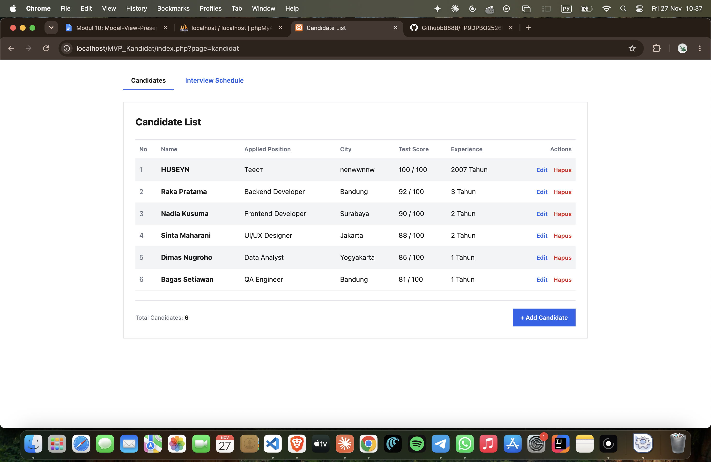
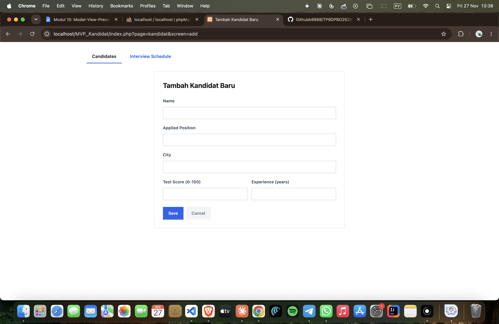
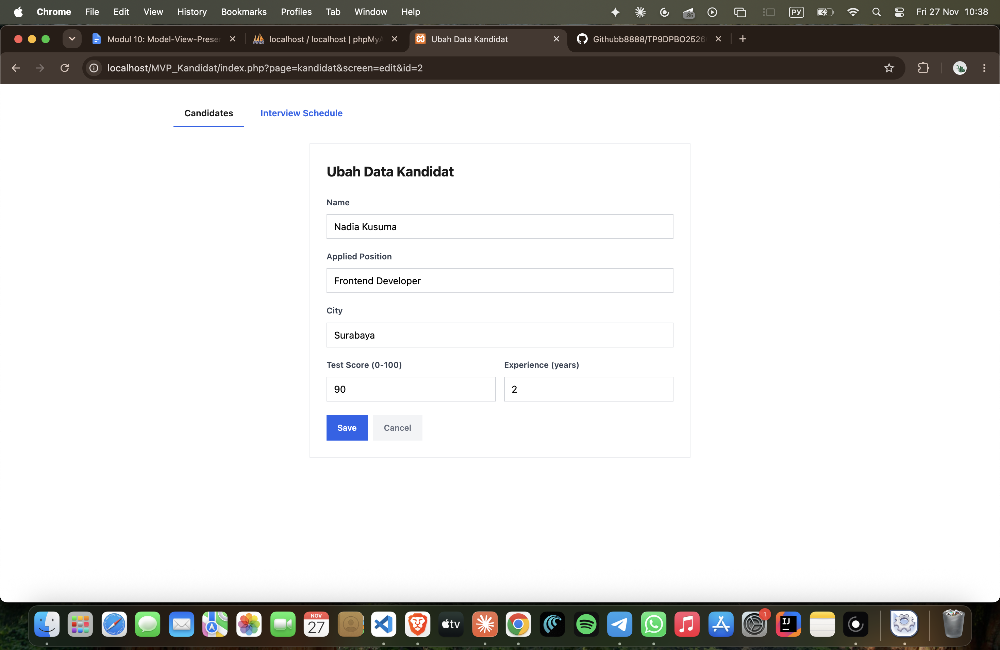
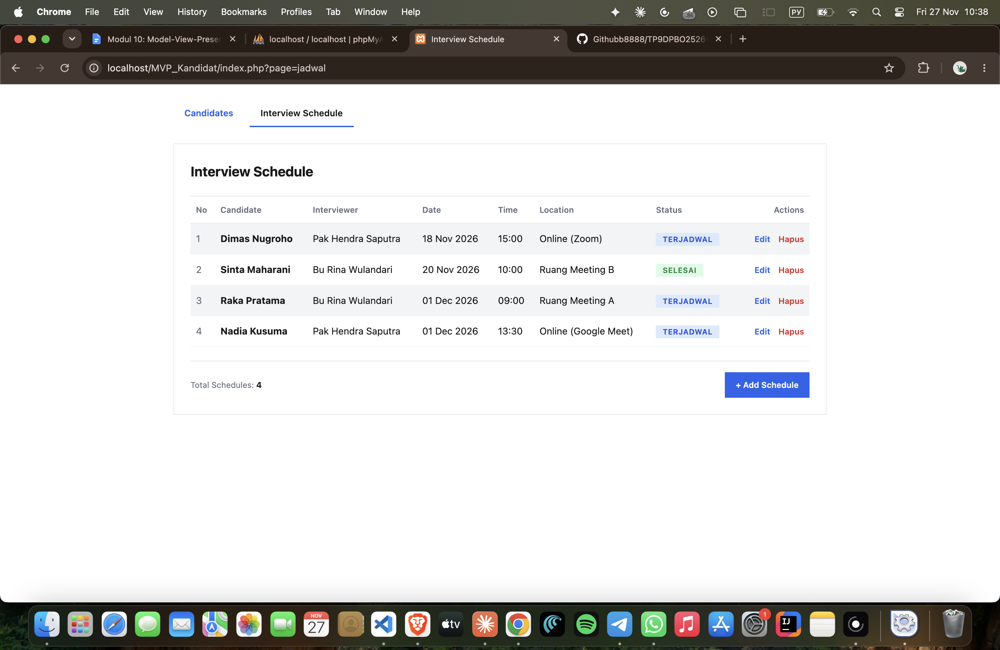
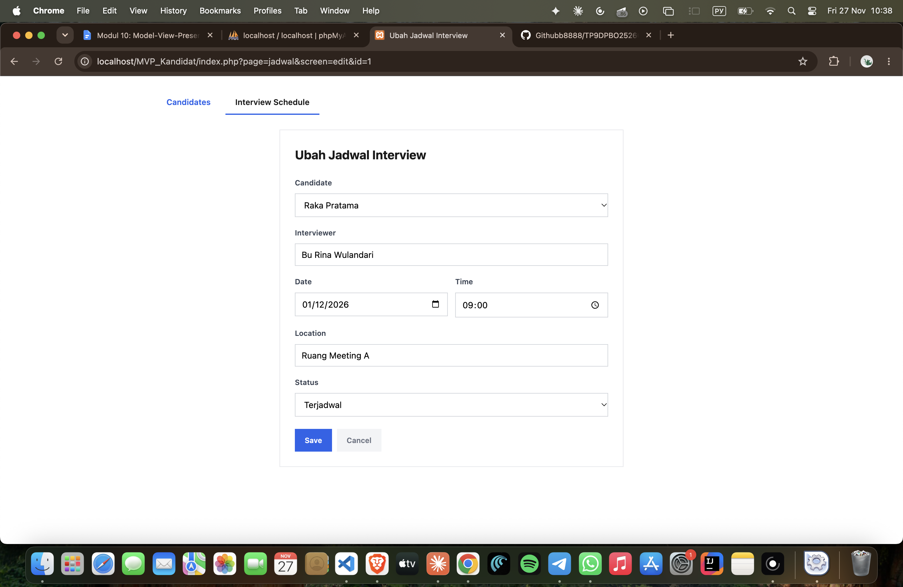

# TP9DPBO2526C1

# Recruitment System (PHP Native MVP)

Tugas Praktikum 9 DPBO 2026

Janji Saya Bozorov Huseyn (NIM: 2521812) mengerjakan Tugas Praktikum 9 dalam mata kuliah Desain dan Pemrograman Berorientasi Objek untuk keberkahannya maka saya tidak melakukan kecurangan seperti yang telah dispesifikasikan. Aamiin.

A PHP Native web application for a recruitment system, built with the Model-View-Presenter (MVP) architecture in the Strict Passive View style, using PDO and prepared statements.

## Website Theme

The theme is recruitment (HR). Users can manage job candidates and the interview schedules of those candidates. Both entities have full CRUD (Create, Read, Update, Delete).

The starter project only had the candidate list. In this assignment the CRUD of the kandidat table was completed, and a new MVP module for the jadwal_interview table was added.

## Database

The database is called mvp_kandidat_db and contains two tables. The full structure and sample data are in mvp_db.sql.

kandidat (original table) stores the job candidates. Columns: id (primary key), nama, posisi, domisili, skorTes and pengalamanTahun.

jadwal_interview (new table) stores the interview schedules. Columns: id (primary key), kandidat_id, pewawancara, tanggal, jam, lokasi and status (Terjadwal, Selesai or Dibatalkan).

Relation: jadwal_interview.kandidat_id is a foreign key to kandidat.id with ON DELETE CASCADE. Deleting a candidate also deletes the interview schedules of that candidate. The relation is optional in the assignment, and it is used here so the schedule list can show the candidate name (JOIN) and the form can pick a candidate from a dropdown.

## Project Structure

project/models/ contains the data layer. DB.php creates the PDO connection and offers executeQuery and getAllResult to the table classes. Kandidat.php and JadwalInterview.php are entity classes. KontrakModel.php and KontrakModelJadwal.php are the interfaces of the models. TabelKandidat.php and TabelJadwal.php extend DB, implement those interfaces and hold the prepared statements. The models never produce HTML.

project/views/ contains the passive views. KontrakView.php and KontrakViewJadwal.php are the interfaces, ViewKandidat.php and ViewJadwal.php are the implementations. A view only reads an HTML file from the template folder and replaces the placeholder tokens (for example {{TABLE_ROWS}} and {{TOTAL_DATA}}) with ready-made strings. There is no require_once, no foreach, no count() and no reference to a Model or an entity class inside this folder.

project/presenters/ contains the logic layer. KontrakPresenter.php and KontrakPresenterJadwal.php are the interfaces, PresenterKandidat.php and PresenterJadwal.php are the implementations. A presenter receives the model and the view through the constructor as interface types, asks the model for data, counts the rows, builds the table rows and dropdown options (buildRowHtml, buildOpsiKandidat, buildOpsiStatus), validates the input and then calls the view.

project/template/ contains the HTML files (skin.html, form.html, skin_jadwal.html, form_jadwal.html) and style.css.

project/index.php is the entry point and the router.

mvp_db.sql is the exported database with the new table.

dokumentasi/ contains the screenshots and the screen recording.

## Code Flow

1. The browser sends a request to index.php, for example index.php?page=jadwal. The page parameter is checked against a whitelist (kandidat, jadwal) and falls back to kandidat. The optional parameters screen (list, add, edit) and id choose which screen is shown.
2. index.php creates the Model, the View and the Presenter of the requested page and injects the Model and the View into the Presenter.
3. If the request is a POST, index.php reads the action field (tambah, ubah or hapus) and calls the matching Presenter method (for example tambahKandidat or hapusJadwal). The Presenter trims and validates the input, then calls the Model, which runs a prepared statement. After that index.php redirects back to the list page (Post/Redirect/Get), so a page refresh does not submit the form twice.
4. If the request is a GET, index.php calls tampilkanKandidat or tampilkanJadwal for the list, or tampilkanFormKandidat or tampilkanFormJadwal for the form.
5. For the list, the Presenter gets an array of entity objects from the Model, counts them, assembles the table rows and sends the finished strings to the View.
6. The View loads the template, replaces the tokens and returns the finished HTML string, which index.php echoes to the browser.
7. For the edit form, the Presenter loads one row with getKandidatById or getJadwalById, turns it into a simple array and sends it to the View, which fills the form (prefill). If the id does not exist, the user is redirected to the list. For the schedule form, the Presenter also builds the candidate dropdown from the Model and marks the selected option.
8. Submitting the form sends the action ubah (or tambah) as a POST and the cycle continues from step 3.

Validation in the Presenter: text fields must not be empty, skorTes is limited to 0-100, pengalamanTahun cannot be negative, the date and time of a schedule must have a valid format, and an unknown status falls back to Terjadwal. Invalid input is ignored and the user is sent back to the list.

All queries use prepared statements with named placeholders, so user input is never concatenated into SQL. All dynamic output is escaped with htmlspecialchars. Deleting is done with a POST form and a confirmation dialog instead of a plain link.

## How to Run

1. Start Apache and MySQL (XAMPP, MAMP, Laragon) or install PHP and MySQL locally.
2. Import mvp_db.sql with phpMyAdmin or the mysql command line. It creates the database mvp_kandidat_db with both tables and sample data.
3. Check the credentials at the top of project/index.php (DB_HOST, DB_NAME, DB_USER, DB_PASS).
4. Put the project folder in htdocs (XAMPP) or www (Laragon), for example as htdocs/MVP_Kandidat, and open http://localhost/MVP_Kandidat/index.php. Alternatively, run php -S localhost:8000 inside the project folder and open http://localhost:8000.

## Run Documentation

A screen recording of the website running, where CRUD is tried on both tables, is available on Google Drive.

| Description | Google Drive Link (Screen Recording) |
|---|---|
| Demo and Program Flow | [https://drive.google.com/file/d/https://drive.google.com/file/d/1AtfV7GzeJMmHN0ciXRZ8RZ3wKUjACWtd/view?usp=sharing/view?usp=sharing](https://drive.google.com/file/d/1AtfV7GzeJMmHN0ciXRZ8RZ3wKUjACWtd/view?usp=sharing) |

Candidate list:

Add candidate:

Edit candidate:

Interview schedule list:

Edit schedule:

